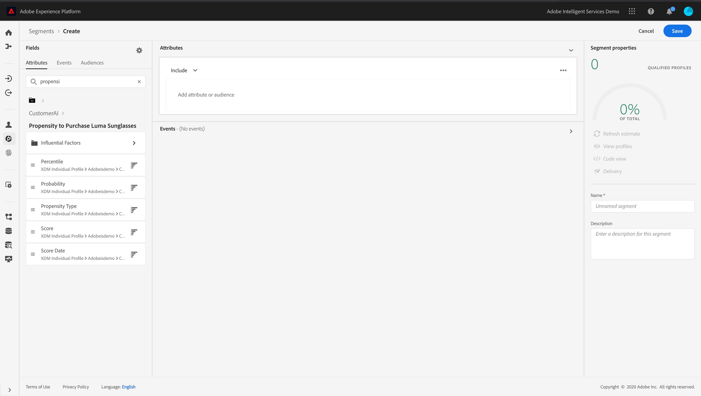

# 善用客戶 AI {#customer-ai}

>[!CAUTION]
>
>**正在尋找 Adobe Journey Optimizer**？ 按一下[這裡](https://experienceleague.adobe.com/zh-hant/docs/journey-optimizer/using/ajo-home){target="_blank"}以取得 Journey Optimizer 文件。
>
>
>_本文件指的是已由 Journey Optimizer 取代的舊版 Journey Orchestration 資料。 如果您對 Journey Orchestration 或 Journey Optimizer 的存取權有任何疑問，請聯絡您的帳戶團隊。_

Customer AI是Intelligent Services的一部分。 這有助於預測客戶可能會做什麼。 請參閱[檔案](https://experienceleague.adobe.com/docs/experience-platform/intelligent-services/customer-ai/overview.html)。

Customer AI可讓品牌建立流失率或轉換機器學習型分數，這些分數將在Adobe Experience Platform設定檔（即時客戶設定檔）中作為設定檔屬性提供。

因此，它們可以當作Journey Orchestration條件（以做出最佳決策）、動作或區段建立中的任何其他設定檔屬性使用。

請注意，Customer AI是Adobe Experience Platform的付費功能。
