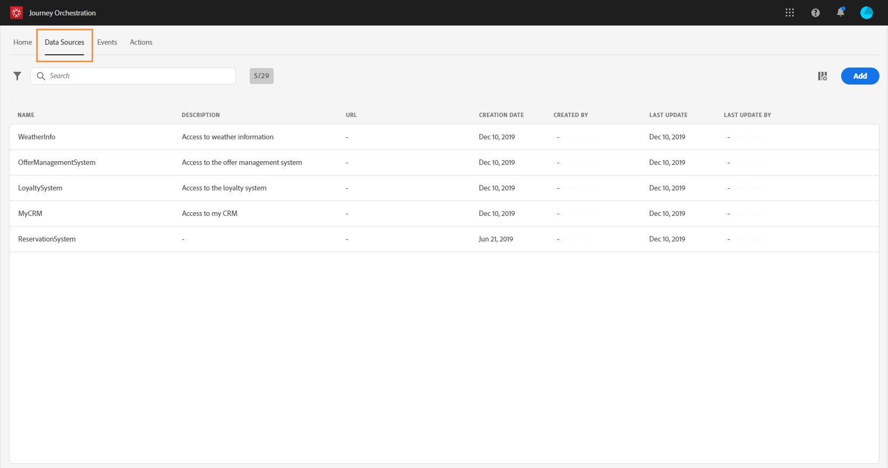
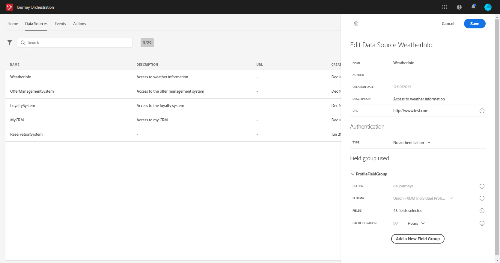

# 關於資料來源 {#concept_s1s_dqt_52b}

>[!CAUTION]
>
>**正在尋找 Adobe Journey Optimizer**？ 按一下[這裡](https://experienceleague.adobe.com/zh-hant/docs/journey-optimizer/using/ajo-home){target="_blank"}以取得 Journey Optimizer 文件。
>
>
>_本文件指的是已由 Journey Optimizer 取代的舊版 Journey Orchestration 資料。 如果您對 Journey Orchestration 或 Journey Optimizer 的存取權有任何疑問，請聯絡您的帳戶團隊。_

>[!CONTEXTUALHELP]
>id="jo_datasources"
>title="關於資料來源"
>abstract="此資料來源設定可讓您定義系統連線，以擷取將用於歷程的其他資訊。"

資料來源設定可讓您定義系統連線，以擷取將用於歷程的其他資訊，例如：

* [條件定義](../building-journeys/condition-activity.md)
* [動作](../action/action.md)中的參數和個人化資料
* [自訂等待定義](../building-journeys/wait-activity.md#custom)
* [時區定義](../building-journeys/timezone-management.md)

如果您的歷程僅善用來自事件承載的本機資料，則不需要進行此設定。 例如，如果您的歷程由事件和僅使用事件資料的電子郵件活動組成，則不需要設定資料來源。

資料來源有兩種類型：

* 預先設定的 Adobe Experience Platform 資料來源可定義「即時客戶輪廓」的連線。 這是內建的資料來源。 請參閱[此頁面](../datasource/adobe-experience-platform-data-source.md)。
* 外部資料來源可讓您定義與外部系統的連線。 這些是您可以建立的資料來源。 請參閱[此頁面](../datasource/external-data-sources.md)。

對於每個資料來源，您會使用欄位群組來定義要擷取的資訊。 欄位群組是可從資料來源擷取的欄位集。 請參閱[此頁面](../datasource/field-groups.md)。

以下是主要的資料來源設定步驟：

>[!NOTE]
>
>資料來源設定一律會由&#x200B;**技術使用者**&#x200B;執行。

1. 在功能表窗格中，選取&#x200B;**[!UICONTROL Admin]**。 在&#x200B;**[!UICONTROL Data sources]**&#x200B;區段中，按一下&#x200B;**[!UICONTROL Manage]**。

   畫面隨即顯示資料來源。 如需介面的詳細資訊，請參閱[此頁面](../about/user-interface.md)。

   

1. 然後，您可以將欄位群組新增至內建的資料來源（請參閱[此頁面](../datasource/adobe-experience-platform-data-source.md)），或建立新的外部資料來源（請參閱[此頁面](../datasource/external-data-sources.md)）和相關聯的欄位群組（請參閱[此頁面](../datasource/field-groups.md)）。

   

1. 按一下「**[!UICONTROL Save]**」。

   資料來源現在已設定完畢，且可供您在歷程中使用。
