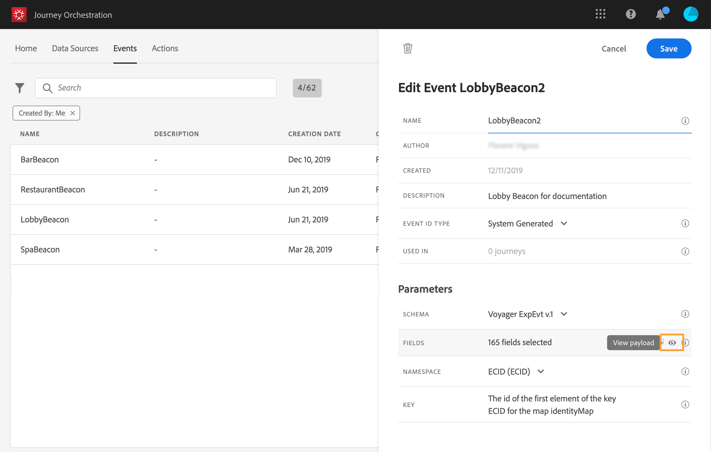
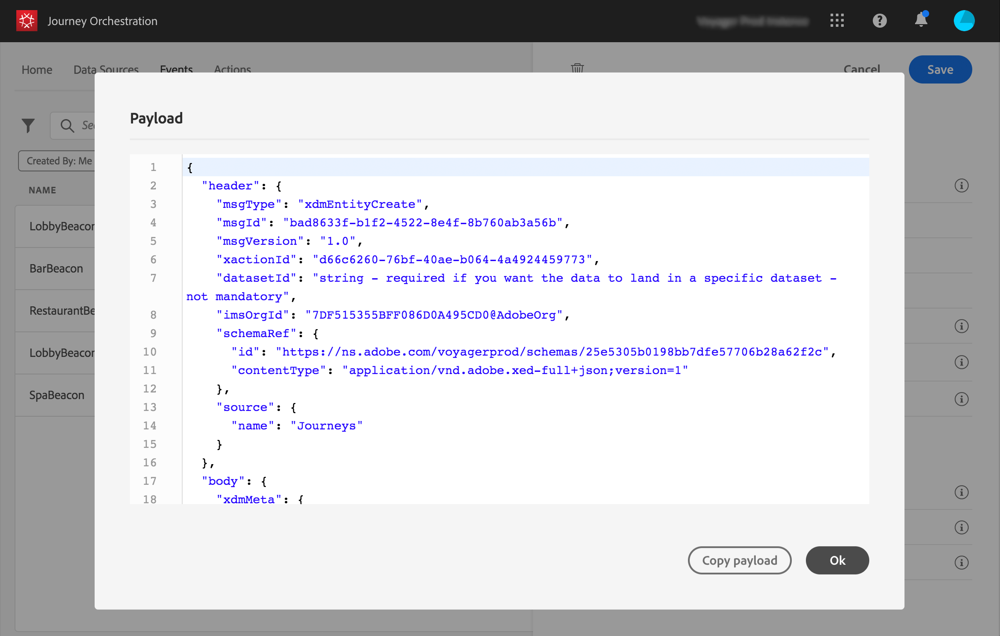

# 預覽裝載 {#concept_jgf_4yk_4fb}

>[!CAUTION]
>
>**正在尋找 Adobe Journey Optimizer**？ 按一下[這裡](https://experienceleague.adobe.com/zh-hant/docs/journey-optimizer/using/ajo-home){target="_blank"}以取得 Journey Optimizer 文件。
>
>
>_本文件指的是已由 Journey Optimizer 取代的舊版 Journey Orchestration 資料。 如果您對 Journey Orchestration 或 Journey Optimizer 的存取權有任何疑問，請聯絡您的帳戶團隊。_

裝載預覽可讓您驗證裝載定義。

>[!NOTE]
>
>對於系統產生的事件，當您建立事件時，在檢視裝載預覽之前，請儲存事件並重新開啟。 在裝載中產生事件ID時，需要執行此步驟。

1. 按一下&#x200B;**[!UICONTROL View Payload]**&#x200B;圖示以預覽系統預期的裝載。

   

   您可以注意到已選取的欄位已顯示。

   

1. 檢查預覽以驗證裝載定義。

1. 然後，您可以將裝載預覽與共用給負責事件傳送的人員。 此承載可協助他們設計推送至[!DNL Journey Orchestration]之事件的設定。 請參閱[此頁面](../event/additional-steps-to-send-events-to-journey-orchestration.md)。
