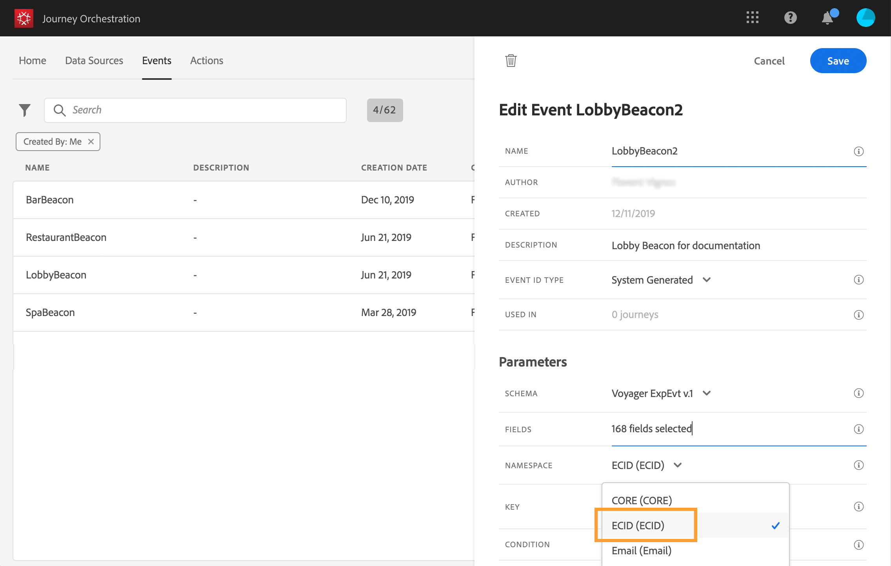

# 選取命名空間 {#concept_ckb_3qt_52b}

>[!CAUTION]
>
>**正在尋找 Adobe Journey Optimizer**？ 按一下[這裡](https://experienceleague.adobe.com/zh-hant/docs/journey-optimizer/using/ajo-home){target="_blank"}以取得 Journey Optimizer 文件。
>
>
>_本文件指的是已由 Journey Optimizer 取代的舊版 Journey Orchestration 資料。 如果您對 Journey Orchestration 或 Journey Optimizer 的存取權有任何疑問，請聯絡您的帳戶團隊。_

名稱空間可讓您定義用來識別與事件相關聯之人員的金鑰型別。 其設定是選用的。 如果您想要在歷程中擷取來自[即時客戶個人檔案](https://experienceleague.adobe.com/docs/experience-platform/profile/home.html?lang=zh-Hant)的其他資訊，則需要此專案。 如果您僅使用來自協力廠商系統的資料，透過自訂資料來源，則不需要名稱空間定義。

您可以使用其中一個預先定義的名稱空間，或使用「身分名稱空間」服務建立新的名稱空間。 請參見此[頁面](https://experienceleague.adobe.com/docs/experience-platform/identity/home.html?lang=zh-Hant)。

如果您選取具有主要身分的結構描述，則會預先填入&#x200B;**[!UICONTROL Key]**&#x200B;和&#x200B;**[!UICONTROL Namespace]**&#x200B;欄位。 如果未定義任何身分，我們選取&#x200B;_identityMap > id_&#x200B;作為主索引鍵。 接著，您必須選取名稱空間，而且會使用&#x200B;_identityMap > id_&#x200B;預先填入金鑰（**[!UICONTROL Namespace]**&#x200B;欄位下方）。

選取欄位時，會標籤主要身分欄位。

從下拉式清單中選取名稱空間。

每個歷程只允許一個名稱空間。 如果您在同一個歷程中使用數個事件，則需要使用相同的名稱空間。 請參閱[此頁面](../building-journeys/journey.md)。
