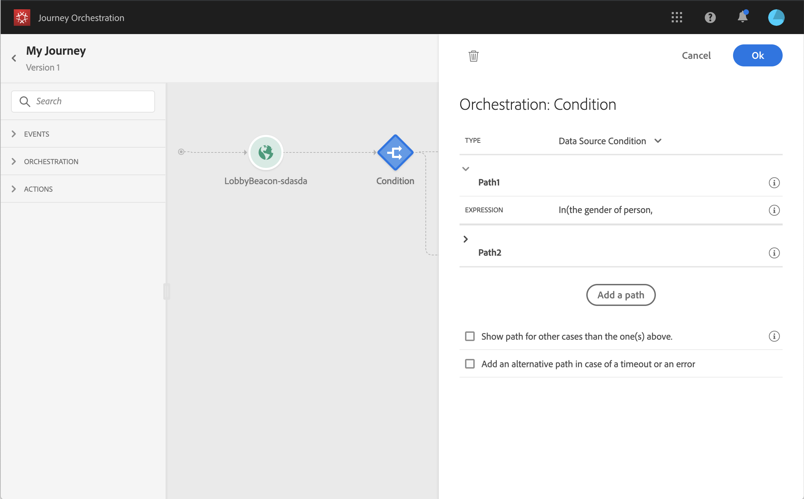
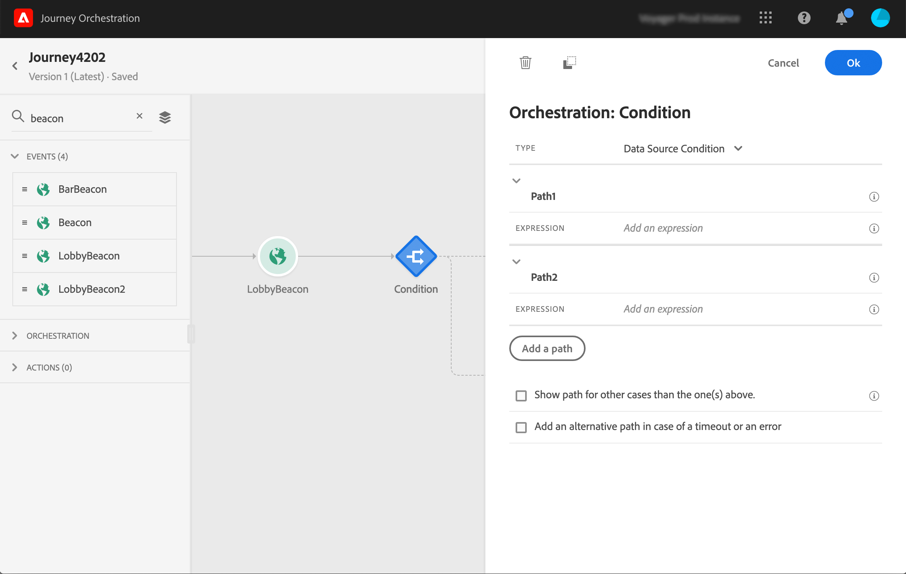
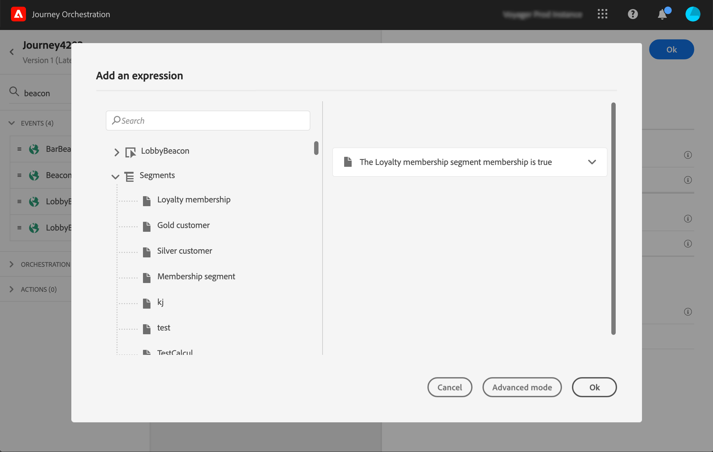

# 在條件中使用區段 {#using-a-segment}

>[!CAUTION]
>
>**正在尋找 Adobe Journey Optimizer**？ 按一下[這裡](https://experienceleague.adobe.com/zh-hant/docs/journey-optimizer/using/ajo-home){target="_blank"}以取得 Journey Optimizer 文件。
>
>
>_本文件指的是已由 Journey Optimizer 取代的舊版 Journey Orchestration 資料。 如果您對 Journey Orchestration 或 Journey Optimizer 的存取權有任何疑問，請聯絡您的帳戶團隊。_

本節說明如何在歷程條件中使用區段。 若要瞭解如何在歷程中使用&#x200B;**[!UICONTROL Segment qualification]**&#x200B;事件，請參閱此[區段](../building-journeys/segment-qualification-events.md)。

若要在歷程條件中使用區段，請遵循下列步驟：

1. 開啟歷程、拖放&#x200B;**[!UICONTROL Condition]**&#x200B;活動並選擇&#x200B;**資料Source條件**。
   

1. 按一下「**[!UICONTROL Add a path]**」以取得每個所需的額外路徑。 對於每個路徑，按一下&#x200B;**[!UICONTROL Expression]**&#x200B;欄位。

   

1. 在左側，展開&#x200B;**[!UICONTROL Segments]**&#x200B;節點。 拖放您要用於條件的區段。 依預設，區段的條件為true。

   

   >[!NOTE]
   >
   >只有具有&#x200B;**已實現**&#x200B;和&#x200B;**現有**&#x200B;區段參與狀態的個人才會被視為區段的成員。 如需如何評估區段的詳細資訊，請參閱[Segmentation Service檔案](https://experienceleague.adobe.com/docs/experience-platform/segmentation/tutorials/evaluate-a-segment.html?lang=zh-Hant#interpret-segment-results)。

如需歷程條件以及如何使用簡單運算式編輯器的詳細資訊，請參閱[條件活動](../building-journeys/condition-activity.md#about_condition)。
