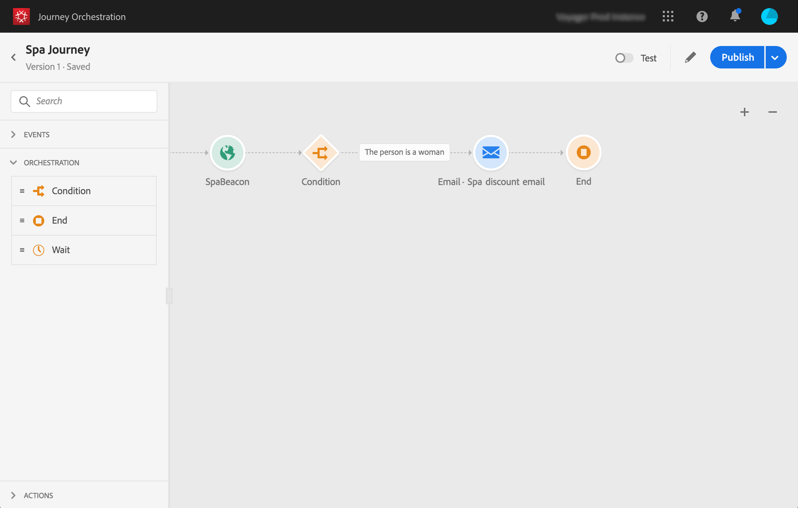

# 關於簡單使用案例{#concept_grh_vby_w2b}

>[!CAUTION]
>
>**正在尋找 Adobe Journey Optimizer**？ 按一下[這裡](https://experienceleague.adobe.com/zh-hant/docs/journey-optimizer/using/ajo-home){target="_blank"}以取得 Journey Optimizer 文件。
>
>
>_本文件指的是已由 Journey Optimizer 取代的舊版 Journey Orchestration 資料。 如果您對 Journey Orchestration 或 Journey Optimizer 的存取權有任何疑問，請聯絡您的帳戶團隊。_

## 目的 {#purpose}

以一個名為Marlton的飯店品牌為例。 他們在飯店中，在所有策略區域附近都放置了信標裝置：大廳、地板、餐廳、健身房、游泳池等。

在此使用案例中，我們將瞭解如何即時傳送個人化訊息給位在spa附近信標旁邊的人。

我們只想在該人是女性時傳送訊息。 訊息必須在秒內收到。

## 先決條件 {#prerequisites}

針對我們的使用案例，我們在Adobe Campaign Standard中設計了一個電子郵件交易式訊息範本。 我們正在使用事件交易式訊息範本。 請參見此[頁面](https://experienceleague.adobe.com/docs/campaign-standard/using/communication-channels/transactional-messaging/getting-started-with-transactional-msg.html?lang=zh-Hant)。

Adobe Campaign Standard已設定為傳送電子郵件。

在信標附近偵測到事件時，會從客戶的行動電話傳送事件。 您需要設計行動應用程式，將事件從客戶的行動電話傳送至Mobile SDK。
